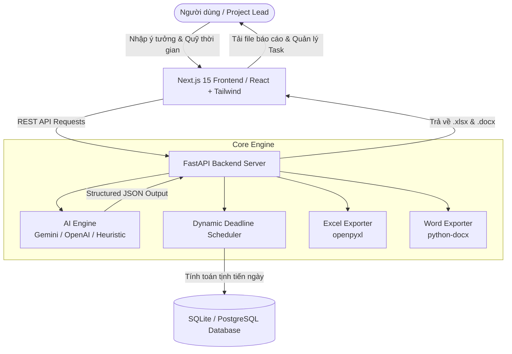

# ⚡ Chronomind — AI-Powered Dynamic Project & Deadline Planner

[](https://fastapi.tiangolo.com)
[](https://nextjs.org)
[](https://tailwindcss.com)
[](https://ai.google.dev)
[](https://opensource.org/licenses/MIT)

> **Chronomind** là hệ thống Quản lý Dự án & Lập lịch Thông minh tích hợp AI đóng vai trò như một **AI Project Manager**. Hệ thống giải quyết bài toán cốt lõi: Người dùng có ý tưởng (phần mềm, phần cứng IoT, nghiên cứu, kinh doanh...) nhưng chưa hình dung được quy mô, độ khó, các bước thực hiện và thời gian khả thi. Chronomind tự động phân tích ý tưởng, cảnh báo điểm mù, thiết lập checklist tiền dự án, kích hoạt deadline động và xuất báo cáo WBS chuyên nghiệp ra Excel & Word.

---

## 📑 Mục lục
1. [Điểm nổi bật & Tính năng cốt lõi](#-tính-năng-cốt-lõi-core-features)
2. [Kiến trúc hệ thống (System Architecture)](#-kiến-trúc-hệ-thống)
3. [Tech Stack](#-tech-stack)
4. [Cấu trúc thư mục chuẩn](#-cấu-trúc-thư-mục-chuẩn)
5. [Thiết kế Database Schema](#-thiết-kế-database-schema)
6. [Hướng dẫn cài đặt & Khởi chạy nhanh](#-hướng-dẫn-cài-đặt--chạy-dự-án)
7. [API Endpoints](#-danh-sách-api-endpoints)
8. [Lộ trình phát triển (Roadmap)](#-lộ-trình-phát-triển-roadmap)

---

## 🌟 Tính năng cốt lõi (Core Features)

### 1. AI Đánh giá Khả thi & Điểm mù (AI Feasibility & Complexity Analyzer)
* **Đầu vào linh hoạt:** Người dùng chỉ cần nhập mô tả ý tưởng (dù còn mơ hồ), mục tiêu mong muốn, số giờ rảnh mỗi tuần (5h - 40h), và trình độ hiện tại.
* **Chấm điểm độ khó (1.0 - 10.0):** AI phân tích rủi ro kỹ thuật, phân loại dự án (Hardware IoT, AI/ML, Fullstack Web, Business) và đưa ra điểm số kèm nhận định chuyên môn.
* **Cảnh báo Điểm mù (Blind Spots):** Nhắc nhở những điều người dùng "chưa hình dung tới" (VD: làm phần cứng thì cần thời gian đặt mạch/linh kiện, làm web cần thời gian deploy & fix bug, chi phí token LLM, hoặc rủi ro re-spin PCB).
* **Checklist Tiền Dự Án (Prerequisites):** Liệt kê danh mục chuẩn bị phân loại rõ theo: *Kiến thức (Knowledge), Thiết bị (Equipment), Môi trường (Environment), Tài nguyên (Resource)* cần hoàn tất trước khi bắt tay làm thật.

### 2. Kích hoạt Thông minh & Deadline Động (Smart Trigger & Dynamic Deadline)
* **Chế độ Chờ Chuẩn Bị (Preparation Mode):** Đồng hồ đếm ngược **CHƯA** chạy ngay khi tạo dự án. Người dùng thoải mái chuẩn bị đồ đạc và tick vào checklist.
* **Smart Trigger (Kick-off):** Chỉ khi người dùng bấm nút **"Sẵn sàng bắt đầu" (Ready to Kick-off)**, hệ thống mới chính thức quy đổi khối lượng giờ sang ngày lịch thực tế dựa trên quỹ thời gian rảnh mỗi tuần, tự động gán ngày bắt đầu và ngày hoàn thành cho từng Phase và Task.
* **Gia hạn Thông minh (Smart Rescheduling / Extension):** Khi bị trễ hạn hoặc gặp sự cố bất khả kháng, người dùng có thể gửi yêu cầu gia hạn (+N ngày) kèm lý do. AI Rescheduling Engine đánh giá mức độ ảnh hưởng, đưa ra lời khuyên gỡ rối, và **tự động tịnh tiến (downstream shift)** toàn bộ các Phase tiếp theo mà không làm vỡ cấu trúc tổng thể.

### 3. Xuất Báo cáo Tiến độ Tự động (Automated Document & Report Exporter)
* **Xuất file Excel (`.xlsx`):**
  - **Sheet 1 (Project Summary):** Thẻ KPI tổng quan, điểm số AI, bảng checklist chuẩn bị kèm trạng thái.
  - **Sheet 2 (WBS & Schedule):** Bảng phân rã công việc (Work Breakdown Structure) chi tiết từng Phase/Task, gắn nhãn Milestone (★), cột ngày dự kiến, và tự động tô màu có điều kiện (Conditional Formatting: Xanh lá cho Done, Xanh dương cho In Progress, Đỏ hồng cho Delayed).
  - **Sheet 3 (Extension History):** Nhật ký gia hạn, số ngày đã lùi và phân tích từ AI.
* **Xuất file Word (`.docx`):** Bản báo cáo tiến độ chuẩn chỉnh (Project Status Report) gồm: Tóm tắt dự án, Đánh giá độ khó ban đầu, Danh sách điểm mù, Bảng tiến độ từng Phase, và Nhật ký sự cố.

---

## 🏛️ Kiến trúc hệ thống



---

## 💻 Tech Stack

| Tầng | Công nghệ | Mục đích |
|---|---|---|
| **Frontend** | Next.js 15 (App Router), React, TypeScript | Giao diện Single Page reactive, chuẩn SEO và hiệu năng cao |
| **Giao diện & UI** | Tailwind CSS v4, Lucide React, Canvas Confetti | Giao diện hiện đại, Dark Mode mặc định, hiệu ứng sinh động |
| **Backend** | Python FastAPI, Uvicorn | Hiệu năng cao, xử lý bất đồng bộ, tích hợp AI mượt mà |
| **Cơ sở dữ liệu** | SQLAlchemy 2.0, SQLite (hỗ trợ chuyển PostgreSQL) | ORM linh hoạt, dễ dàng chạy local không cần cài DB server phức tạp |
| **Xử lý Báo cáo** | `openpyxl`, `python-docx` | Xuất file bảng tính Excel và văn bản Word chuẩn văn phòng |
| **AI Integration** | Google Gemini API / OpenAI API / Heuristic fallback | Đảm bảo hệ thống hoạt động 100% kể cả khi không có API key (offline demo) |

---

## 📂 Cấu trúc thư mục chuẩn

```
Chronomind/
├── backend/
│   ├── app/
│   │   ├── api/
│   │   │   ├── endpoints/
│   │   │   │   ├── projects.py       # CRUD, phân tích AI, Kick-off, Gia hạn
│   │   │   │   ├── tasks.py          # Cập nhật trạng thái task, hoàn thành phase
│   │   │   │   ├── prerequisites.py  # Toggle checklist chuẩn bị
│   │   │   │   └── exports.py        # Tải file Excel & Word
│   │   │   └── api.py                # Tổng hợp Router
│   │   ├── models/
│   │   │   └── models.py             # Schema Project, Phase, Task, Prerequisite, ExtensionLog
│   │   ├── schemas/
│   │   │   └── schemas.py            # Pydantic schemas & AI Structured Output
│   │   ├── services/
│   │   │   ├── ai_engine.py          # Kết nối LLM & Heuristic planner thông minh
│   │   │   ├── scheduler.py          # Thuật toán tính deadline động & tịnh tiến lịch
│   │   │   ├── exporter_excel.py     # Định dạng bảng tính WBS Excel (.xlsx)
│   │   │   └── exporter_word.py      # Định dạng báo cáo Word (.docx)
│   │   ├── config.py                 # Biến môi trường & cấu hình hệ thống
│   │   ├── database.py               # Session & kết nối SQLAlchemy
│   │   └── main.py                   # FastAPI Application entrypoint
│   ├── requirements.txt              # Danh sách thư viện Python
│   ├── Dockerfile                    # Docker build backend
│   └── .env.example                  # File mẫu biến môi trường backend
├── frontend/
│   ├── src/
│   │   ├── app/
│   │   │   ├── layout.tsx            # Root layout Next.js
│   │   │   ├── globals.css           # Tailwind CSS styles
│   │   │   └── page.tsx              # Giao diện chính Dashboard & Workspace
│   │   ├── components/
│   │   │   ├── Navbar.tsx            # Thanh điều hướng & chuyển đổi dự án
│   │   │   ├── ProjectWizardModal.tsx# Modal phân tích ý tưởng bằng AI
│   │   │   ├── FeasibilityCard.tsx   # Thẻ đánh giá độ khó (1-10) & Điểm mù
│   │   │   ├── PreparationBanner.tsx # Chế độ Preparation & Nút Kick-off
│   │   │   ├── TimelineRoadmap.tsx   # Danh sách Phase, Task, Milestone
│   │   │   ├── RescheduleModal.tsx   # Modal xin gia hạn thông minh
│   │   │   ├── ExtensionHistoryDrawer.tsx # Lịch sử trễ hạn & lời khuyên AI
│   │   │   └── ExportMenu.tsx        # Menu tải file Excel / Word
│   │   ├── services/
│   │   │   └── api.ts                # Client kết nối Backend API
│   │   └── types/
│   │       └── index.ts              # TypeScript interfaces
│   ├── package.json
│   ├── Dockerfile                    # Docker build frontend
│   └── tsconfig.json
├── docker-compose.yml                # Chạy toàn bộ hệ thống bằng 1 lệnh
├── start-dev.bat                     # Chạy nhanh local trên Windows
├── start-dev.sh                      # Chạy nhanh local trên Linux/macOS
├── .env.example                      # File mẫu cấu hình toàn cục
└── README.md
```

---

## 🗄️ Thiết kế Database Schema

```
┌──────────────────────────┐         ┌──────────────────────────┐
│         PROJECTS         │ 1     * │      PREREQUISITES       │
├──────────────────────────┼─────────┼──────────────────────────┤
│ id (PK)                  │         │ id (PK)                  │
│ title, description       │         │ project_id (FK)          │
│ target_goal              │         │ title, category          │
│ available_hours_per_week │         │ description              │
│ skill_level              │         │ is_completed, completed_at
│ status (PREP/ACTIVE/DONE)│         └──────────────────────────┘
│ complexity_score (1-10)  │
│ blind_spots (JSON)       │         ┌──────────────────────────┐
│ kick_off_date            │ 1     * │          PHASES          │
│ estimated_completion_date├─────────┼──────────────────────────┤
└──────────────────────────┘         │ id (PK)                  │
             │ 1                     │ project_id (FK)          │
             │                       │ phase_number, title      │
             │ *                     │ estimated_hours, status  │
┌──────────────────────────┐         │ planned_start/end_date   │
│      EXTENSION_LOGS      │         └──────────────────────────┘
├──────────────────────────┤                       │ 1
│ id (PK)                  │                       │ *
│ project_id (FK)          │         ┌──────────────────────────┐
│ phase_id, phase_title    │         │          TASKS           │
│ reason, days_added       │         ├──────────────────────────┤
│ previous/new_deadline    │         │ id (PK)                  │
│ ai_analysis              │         │ phase_id (FK)            │
│ created_at               │         │ title, description       │
└──────────────────────────┘         │ estimated_hours          │
                                     │ is_milestone (Boolean)   │
                                     │ priority (LOW/MED/HIGH)  │
                                     │ status (TODO/IN_PROG/DONE│
                                     │ planned_date             │
                                     └──────────────────────────┘
```

---

## 🚀 Hướng dẫn Cài đặt & Chạy dự án

### Cách 1: Chạy bằng 1 click script (Khuyên dùng)
#### Trên Windows:
Chỉ cần nhấp đúp vào file `start-dev.bat` hoặc mở PowerShell:
```powershell
.\start-dev.bat
```

#### Trên macOS / Linux:
```bash
chmod +x start-dev.sh
./start-dev.sh
```

---

### Cách 2: Chạy bằng Docker Compose
```bash
docker-compose up --build
```
Hệ thống sẽ tự động build Backend (port 8000) và Frontend (port 3000).

---

### Cách 3: Chạy thủ công từng phần

#### 1. Khởi chạy Backend (FastAPI):
```bash
cd backend
python -m venv venv

# Kích hoạt môi trường ảo:
# Trên Windows:
.\venv\Scripts\activate
# Trên macOS/Linux:
# source venv/bin/activate

pip install -r requirements.txt
cp .env.example .env

# Chạy server:
uvicorn app.main:app --reload --port 8000
```
API Documentation tự động có sẵn tại: `http://localhost:8000/docs`

#### 2. Khởi chạy Frontend (Next.js):
```bash
cd frontend
npm install
npm run dev
```
Truy cập ứng dụng tại: `http://localhost:3000`

---

## 🔑 Cấu hình Biến môi trường (.env)

Tạo file `.env` tại thư mục `backend/` (hoặc tại thư mục gốc khi dùng Docker):

```env
# Chronomind Configuration
PROJECT_NAME="Chronomind - AI Dynamic Project Planner"
DATABASE_URL="sqlite:///./chronomind.db"

# Tùy chọn: Nhập API key của bạn để sử dụng model AI mới nhất
# Nếu để trống, Chronomind tự động kích hoạt bộ giả lập heuristic thông minh để demo mượt mà!
GEMINI_API_KEY="your-gemini-api-key"
OPENAI_API_KEY="your-openai-api-key"

DEFAULT_AI_PROVIDER="auto"  # "auto", "gemini", hoặc "openai"
CORS_ORIGINS=["http://localhost:3000","http://127.0.0.1:3000","*"]
```

---

## 📡 Danh sách API Endpoints

| Phương thức | Endpoint | Mô tả |
|---|---|---|
| `POST` | `/api/projects` | Tạo dự án mới kèm phân tích AI (Score, Điểm mù, Checklist, Phases) |
| `GET` | `/api/projects` | Lấy danh sách các dự án kèm % tiến độ |
| `GET` | `/api/projects/{id}` | Lấy chi tiết toàn bộ dự án, phases, tasks và extensions |
| `POST` | `/api/projects/{id}/kickoff` | **Smart Trigger:** Chuyển sang Active & tính deadline động |
| `POST` | `/api/projects/{id}/extend` | **Smart Reschedule:** Xin gia hạn & AI tự tịnh tiến các phase sau |
| `DELETE` | `/api/projects/{id}` | Xóa dự án |
| `PATCH` | `/api/tasks/{task_id}/toggle` | Đánh dấu task Done / In Progress / Todo |
| `POST` | `/api/prerequisites/{id}/toggle` | Đánh dấu hoàn thành hạng mục chuẩn bị |
| `GET` | `/api/projects/{id}/export/excel` | Xuất bảng kế hoạch WBS ra `.xlsx` (kèm conditional color) |
| `GET` | `/api/projects/{id}/export/word` | Xuất báo cáo trạng thái ra `.docx` chuyên nghiệp |

---

## 🗺️ Lộ trình phát triển (Roadmap)

- [x] **v1.0 (Hiện tại):**
  - AI Feasibility & Complexity Analyzer (chấm điểm 1-10 & rà soát điểm mù).
  - Preparation Mode & Smart Kick-off Trigger.
  - Smart Rescheduling tịnh tiến lịch trình khi có sự cố.
  - Xuất bảng WBS Excel & báo cáo Word có định dạng đẹp.
- [ ] **v1.1:** Tích hợp đồng bộ 2 chiều với **Google Calendar** (Tự động tạo sự kiện cho từng Phase & Milestone).
- [ ] **v1.2:** Tích hợp **Telegram Bot & Discord Webhook** nhắc nhở deadline và cảnh báo trễ tiến độ hằng ngày.
- [ ] **v1.3:** Đồng bộ trực tiếp với **GitHub Issues & Projects** (tự tạo milestone và issue tương ứng từ WBS).

---

## 📄 License
Dự án được phân phối dưới giấy phép **MIT License**.
Phát triển bởi cộng đồng Open Source & Google DeepMind Antigravity Agent.
