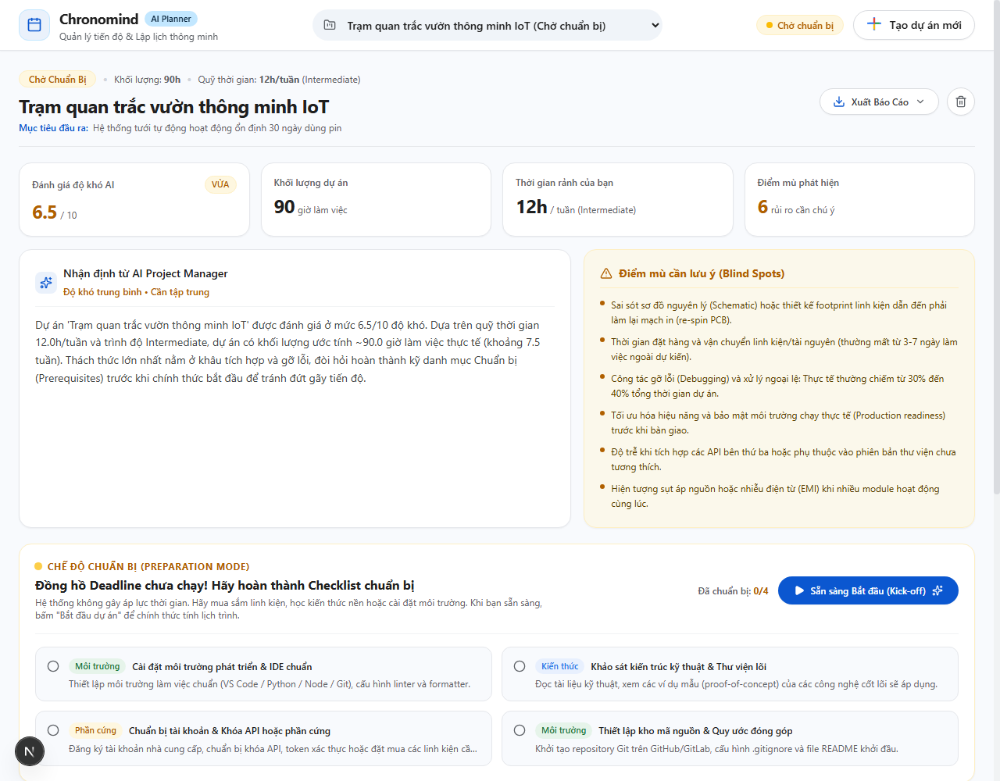
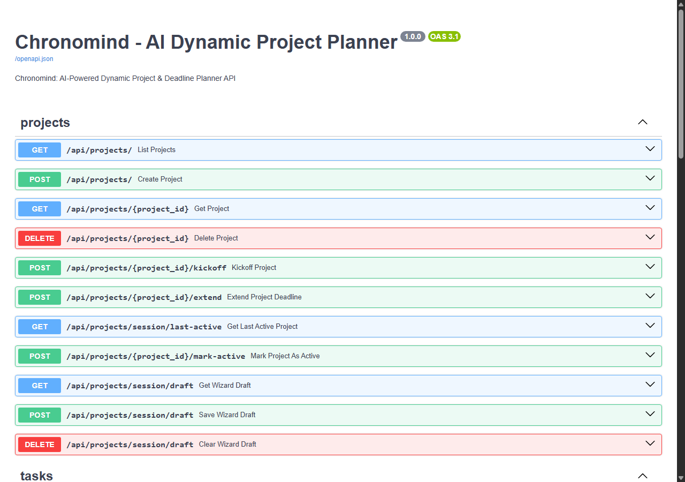
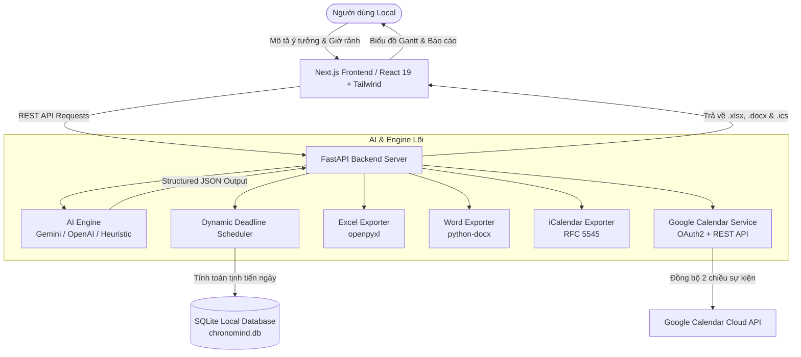

# ⚡ Chronomind — AI-Powered Dynamic Project & Deadline Planner

[](https://fastapi.tiangolo.com)
[](https://nextjs.org)
[](https://tailwindcss.com)
[](https://workspace.google.com)
[](https://opensource.org/licenses/MIT)

> **Chronomind** là hệ thống Quản lý Dự án & Lập lịch Thông minh tích hợp AI đóng vai trò như một **AI Project Manager**. Hệ thống tự động phân tích ý tưởng dự án, chấm điểm độ khó (1-10), cảnh báo điểm mù, thiết lập checklist tiền dự án, kích hoạt deadline động với biểu đồ **Gantt Calendar**, tự động ghi nhớ phiên làm việc trên local và xuất báo cáo WBS chuyên nghiệp ra Excel & Word.

---

## 🚀 HƯỚNG DẪN KHỞI CHẠY NHANH TRÊN MÁY LOCAL (QUICK START)

Bạn có thể chạy dự án trên máy tính cá nhân bằng 1 trong 3 cách cực kỳ đơn giản dưới đây:

### Cách 1: Chạy 1-Click bằng Script (Khuyên dùng)
* **Trên Windows:** Chỉ cần nhấp đúp vào file `start-dev.bat` (hoặc mở PowerShell gõ `.\start-dev.bat`).
* **Trên macOS / Linux:** Mở Terminal và chạy:
  ```bash
  chmod +x start-dev.sh
  ./start-dev.sh
  ```

> 💡 **Tự động thiết lập 100% cho máy mới:** Trong lần đầu tiên chạy trên máy mới (fresh clone), script sẽ tự động kiểm tra, khởi tạo Python Virtualenv (`venv`), cài đặt toàn bộ `requirements.txt` và chạy `npm install` hoàn toàn tự động! Hai server sẽ chạy ngầm (thu nhỏ dưới taskbar để không gây phiền) và tự động mở trình duyệt web. Đồng thời, script sẽ hiển thị địa chỉ IP nội bộ để bạn mở trên điện thoại (iPhone / Android) thông qua cùng mạng Wi-Fi.

---

### Cách 2: Chạy bằng Docker Compose (1 lệnh duy nhất)
```bash
docker-compose up --build
```

---

### Cách 3: Chạy thủ công từng phần

#### 1. Khởi động Backend (FastAPI - Python):
```bash
cd backend
python -m venv venv

# Kích hoạt môi trường ảo:
# Trên Windows:
.\venv\Scripts\activate
# Trên macOS/Linux:
# source venv/bin/activate

pip install -r requirements.txt
cp .env.example .env

# Chạy server API:
uvicorn app.main:app --reload --port 8000
```

#### 2. Khởi động Frontend (Next.js - TypeScript):
```bash
cd frontend
npm install
npm run dev
```

---

### 🌐 Đường dẫn truy cập hệ thống:
* **Giao diện Web (Next.js):** [http://localhost:3000](http://localhost:3000)
* **Tài liệu API tương tác (Swagger UI):** [http://localhost:8000/docs](http://localhost:8000/docs)

---

## 📸 HÌNH ẢNH GIAO DIỆN WEB LOCAL THỰC TẾ

### 1. Giao diện Workspace phong cách Google Workspace / Google Calendar
Toàn bộ giao diện được thiết kế theo theme trắng sáng thanh lịch, tinh tế và thân thiện:
- Thẻ đo lường KPI (Độ khó kỹ thuật, Khối lượng giờ làm, Quỹ thời gian, Điểm mù).
- Nhận định kiến trúc từ Gemini AI Assistant & Hộp cảnh báo điểm mù (Blind spots).
- Banner **Chế độ Chuẩn Bị (Preparation Mode)** & Checklist công việc phong cách Google Tasks.
- Biểu đồ **Gantt Timeline** phong cách sự kiện Google Calendar với vạch chỉ dấu "Hôm nay" màu đỏ và sọc gia hạn màu hổ phách.



---

### 2. Hệ thống Tài liệu API Tương Tác Tự Động (Swagger UI)
Backend FastAPI cung cấp đầy đủ các API chuẩn RESTful cho việc phân tích AI, kích hoạt kick-off, gia hạn downstream phases, xuất file Excel & Word:



---

## 🌟 TÍNH NĂNG CỐT LÕI (CORE FEATURES)

### 1. 🧠 AI Phân Tích Độ Khó & Cảnh Báo Điểm Mù (Feasibility Analyzer)
* **Đầu vào linh hoạt:** Người dùng chỉ cần nhập mô tả ý tưởng (dù sơ khai), mục tiêu đầu ra, số giờ rảnh mỗi tuần (5h - 40h), và trình độ hiện tại.
* **Chấm điểm độ khó (1.0 - 10.0):** Phân loại dự án (Hardware IoT, AI/ML, Fullstack Web, Business) và đưa ra điểm số kèm nhận định chuyên môn.
* **Cảnh báo Điểm mù (Blind Spots):** Nhắc nhở những điều người dùng "chưa hình dung tới" (VD: thời gian chờ giao linh kiện, debug và xử lý ngoại lệ chiếm 30-40% thời gian, sụt áp nguồn/nhiễu EMI, độ trễ API LLM...).
* **Checklist Chuẩn bị (Prerequisites):** Liệt kê danh mục chuẩn bị rõ ràng theo: *Kiến thức (Knowledge), Phần cứng (Hardware), Môi trường (Dev-Env), Tài nguyên (Resource)* cần hoàn tất trước khi bắt tay làm thật.

### 2. ⏱️ Kích Hoạt Thông Minh & Deadline Động (Smart Trigger & Dynamic Phasing)
* **Chế độ Chờ Chuẩn Bị (Preparation Mode):** Đồng hồ đếm ngược **CHƯA** chạy ngay khi tạo dự án. Người dùng thoải mái chuẩn bị đồ đạc và tick vào checklist.
* **Smart Trigger (Kick-off):** Chỉ khi người dùng bấm nút **"Sẵn sàng Bắt đầu (Kick-off)"**, hệ thống mới chính thức quy đổi khối lượng giờ sang ngày làm việc thực tế dựa trên quỹ thời gian rảnh mỗi tuần, phân bổ ngày bắt đầu/kết thúc cho từng Phase và Task, đồng thời bắn pháo hoa ăn mừng!
* **Gia hạn Thông minh (Smart Rescheduling):** Khi bị trễ hạn, người dùng gửi yêu cầu (+N ngày) kèm lý do. Hệ thống kích hoạt thuật toán **tịnh tiến các Phase phía sau (Downstream Shifts)**, giữ nguyên tiến độ các Phase đã xong và cập nhật hạn chót dự kiến.

### 3. 📅 Biểu Đồ Gantt Trực Quan Dạng Google Calendar
* **Trục thời gian tương tác (Dynamic Timescale):** Hỗ trợ xem linh hoạt theo từng Ngày (`days`) hoặc Thu nhỏ (`weeks`).
* **Khối sự kiện Calendar (Event Blocks):** Thanh tiến độ bo góc mềm mại, hiển thị trực quan phần việc đã hoàn thành (`progress fill`).
* **Vạch chỉ dấu Gia hạn (Extension Stripes):** Khi một giai đoạn được gia hạn, vùng ngày gia hạn thêm được tô sọc màu hổ phách mềm mại.
* **Cột mốc (Milestones):** Gắn biểu tượng ngôi sao vàng (★) tại các thời điểm đạt cột mốc quan trọng.
* **Vạch "Hôm nay" (Today Marker):** Đường kẻ đứng màu đỏ đánh dấu ngày hiện tại trong toàn bộ lộ trình.

### 4. 💾 Cơ Chế Ghi Nhớ Cục Bộ & Khôi Phục Phiên (Session Persistence)
* **Banner "Tiếp tục công việc trước đó":** Khi mở lại app, hệ thống tự động nhận diện dự án bạn thao tác gần nhất, hiển thị tiến độ và gợi ý ngay **việc tiếp theo cần làm**. Bấm 1 click là tiếp tục công việc ngay lập tức.
* **Tự động lưu bản nháp (Draft Auto-Save):** Tự động ghi nhớ nội dung ý tưởng đang gõ dở vào LocalStorage & SQLite. Lỡ tắt tab hoặc F5 vẫn khôi phục nguyên vẹn 100%.

### 5. 📅 Tích Hợp Google Calendar Linh Hoạt (Hybrid Calendar Integration)
* **Tầng 1 (Tức thì / Zero-Config - Không cần cài đặt):**
  * **Xuất file iCalendar (`.ics`):** Tạo file lịch chuẩn quốc tế RFC 5545 chứa toàn bộ Phase và Milestone. Nhấp đúp để import ngay vào Google Calendar, Apple Calendar, Outlook.
  * **1-Click Web Template:** Mở ngay màn hình tạo sự kiện trên Google Calendar với tiêu đề, ngày giờ và mô tả công việc đã điền sẵn cho từng Phase.
* **Tầng 2 (Nâng cao / Đồng bộ 2 chiều tự động qua Google Calendar API):**
  * **Hướng dẫn trực quan từng bước:** Modal tích hợp hướng dẫn 5 bước chi tiết kèm đường dẫn trực tiếp đến Google Cloud Console và nút **Sao chép 1-Click Redirect URI**.
  * **Trích xuất tự động từ file:** Cho phép dán trực tiếp toàn bộ nội dung file `credentials.json` để hệ thống tự động bóc tách Client ID và Client Secret.
  * **Lịch dự án riêng biệt:** Tự động tạo và quản lý lịch riêng `Chronomind: [Tên dự án]` trên tài khoản Google của bạn.
  * **Đồng bộ thông minh (Upsert theo Deterministic ID):** Khi bạn lùi deadline hoặc dời ngày trong Chronomind, bấm nút **"Đồng bộ ngay"** sẽ tự động dịch chuyển ngày giờ của các sự kiện tương ứng trên Google Calendar thay vì tạo sự kiện mới trùng lặp!
  * **Tự động làm mới Token:** Quản lý `access_token` và tự động refresh token trong nền, không làm gián đoạn trải nghiệm người dùng.

### 6. 📑 Xuất Báo Cáo Chuyên Nghiệp (Excel, Word & Lịch .ics)
* **Xuất file Excel (`.xlsx` qua `openpyxl`):**
  - **Sheet 1 (Project Summary):** Thẻ KPI tổng quan, điểm số AI, bảng checklist chuẩn bị kèm trạng thái.
  - **Sheet 2 (WBS & Schedule):** Bảng Work Breakdown Structure chi tiết từng Phase/Task, gắn nhãn Milestone (★), cột ngày dự kiến, và tự động tô màu có điều kiện (Done: Xanh lá, Running: Xanh dương, Delayed: Đỏ nhạt).
  - **Sheet 3 (Extension History):** Nhật ký gia hạn, số ngày đã lùi và phân tích từ AI.
* **Xuất file Word (`.docx` qua `python-docx`):** Bản báo cáo tình trạng dự án chuẩn chỉnh gồm: Tóm tắt dự án, Đánh giá độ khó ban đầu, Danh sách điểm mù, Bảng tiến độ từng Phase, và Nhật ký sự cố.

### 7. 📱 Tương Thích Di Động Toàn Diện & Trình Giả Lập Viewport (Mobile Simulator)
* **Trình giả lập màn hình trực quan (Interactive Mobile Simulator):**
  * Tích hợp sẵn thanh công cụ giả lập kiểm tra tỉ lệ màn hình của tất cả các dòng thiết bị phổ biến trên thị trường:
    * 🍏 **Apple iOS:** iPhone 16/15 Pro Max (`430x932`, 19.5:9, Dynamic Island), iPhone 16/15/14 (`393x852`), iPhone 13/12 (`390x844`), iPhone SE (`375x667`, 16:9), iPad Mini (`768x1024`, 4:3).
    * 🤖 **Google Android:** Samsung Galaxy S24 Ultra (`412x915`, 20:9, góc vuông), Google Pixel 9/8 Pro (`412x892`), Xiaomi 14 (`393x873`), Android Phổ thông (`360x800`), Android Compact (`360x640`).
    * 🔄 **Foldables & Dual-Screen:** Samsung Galaxy Z Fold 5 (Màn ngoài `344x904` siêu hẹp 23.1:9, Màn mở gập `768x904` gần vuông 10.6:9), Galaxy Z Flip 5 (`412x1004`, 22:9), Microsoft Surface Duo / iPhone Duo Style (`1114x720`, 2 màn hình kép có bản lề giữa).
  * Hỗ trợ xoay ngang/dọc (**Rotate 🔄 Portrait / Landscape**) và zoom co giãn (**50% - 100% / Fit**).
* **Quét mã QR mở trực tiếp trên Điện thoại thật (Wi-Fi Local):**
  * Tự động phát hiện địa chỉ IP Wi-Fi nội bộ (`http://192.168.x.x:3000`).
  * Chỉ cần mở Camera điện thoại quét mã QR là có thể sử dụng ngay lập tức mà không cần cài đặt.
  * Hỗ trợ **PWA (Add to Home Screen)** trên Safari và Chrome để chạy mượt mà như app native toàn màn hình.

---

## 🏛️ KIẾN TRÚC HỆ THỐNG (SYSTEM ARCHITECTURE)



---

## 💻 TECH STACK

| Tầng | Công nghệ | Mục đích |
|---|---|---|
| **Frontend** | Next.js 15 (App Router), React 19, TypeScript | Giao diện Single Page reactive, hiệu năng cao |
| **Giao diện & UI** | Tailwind CSS v4, Lucide Icons, Canvas Confetti | Chuẩn Google Workspace / Material 3, Theme trắng thanh lịch |
| **Backend** | Python FastAPI, Uvicorn | Xử lý bất đồng bộ, phân tích AI và xuất báo cáo |
| **Cơ sở dữ liệu** | SQLAlchemy 2.0, SQLite | Lưu trữ cục bộ nhẹ nhàng, không cần cài server DB phức tạp |
| **Xử lý Báo cáo** | `openpyxl`, `python-docx` | Xuất file bảng tính Excel và văn bản Word chuẩn văn phòng UTF-8 |
| **AI Integration** | Google Gemini API / OpenAI API / Heuristic Fallback | Tự động chạy mượt mà ngay cả khi không có mạng / không có API key |

---

## 🗄️ THIẾT KẾ DATABASE SCHEMA

```
┌──────────────────────────┐         ┌──────────────────────────┐
│         PROJECTS         │ 1     * │      PREREQUISITES       │
├──────────────────────────┼─────────┼──────────────────────────┤
│ id (PK)                  │         │ id (PK)                  │
│ title, description       │         │ project_id (FK)          │
│ target_goal              │         │ title, category          │
│ available_hours_per_week │         │ description              │
│ skill_level              │         │ is_completed, completed_at
│ status (PREP/ACTIVE/DONE)│         └──────────────────────────┘
│ complexity_score (1-10)  │
│ blind_spots (JSON)       │         ┌──────────────────────────┐
│ kick_off_date            │ 1     * │          PHASES          │
│ estimated_completion_date├─────────┼──────────────────────────┤
└──────────────────────────┘         │ id (PK)                  │
             │ 1                     │ project_id (FK)          │
             │                       │ phase_number, title      │
             │ *                     │ estimated_hours, status  │
┌──────────────────────────┐         │ planned_start/end_date   │
│      EXTENSION_LOGS      │         └──────────────────────────┘
├──────────────────────────┤                       │ 1
│ id (PK)                  │                       │ *
│ project_id (FK)          │         ┌──────────────────────────┐
│ phase_id, phase_title    │         │          TASKS           │
│ reason, days_added       │         ├──────────────────────────┤
│ previous/new_deadline    │         │ id (PK)                  │
│ ai_analysis              │         │ phase_id (FK)            │
│ created_at               │         │ title, description       │
└──────────────────────────┘         │ estimated_hours          │
                                     │ is_milestone (Boolean)   │
┌──────────────────────────┐         │ priority (LOW/MED/HIGH)  │
│       SYSTEM_STATE       │         │ status (TODO/IN_PROG/DONE│
├──────────────────────────┤         │ planned_date             │
│ key (PK)                 │         └──────────────────────────┘
│ value (Text/JSON)        │
│ updated_at               │
└──────────────────────────┘
```

---

## 📡 DANH SÁCH API ENDPOINTS

| Phương thức | Endpoint | Mô tả |
|---|---|---|
| `POST` | `/api/projects` | Tạo dự án mới kèm phân tích AI (Score, Điểm mù, Checklist, Phases) |
| `GET` | `/api/projects` | Lấy danh sách các dự án kèm % tiến độ |
| `GET` | `/api/projects/{id}` | Lấy chi tiết toàn bộ dự án, phases, tasks và extensions |
| `POST` | `/api/projects/{id}/kickoff` | **Smart Trigger:** Chuyển sang Active & tính deadline động |
| `POST` | `/api/projects/{id}/extend` | **Smart Reschedule:** Xin gia hạn & AI tự tịnh tiến các phase sau |
| `DELETE` | `/api/projects/{id}` | Xóa dự án |
| `PATCH` | `/api/tasks/{task_id}/toggle` | Đánh dấu task Done / In Progress / Todo |
| `POST` | `/api/prerequisites/{id}/toggle` | Đánh dấu hoàn thành hạng mục chuẩn bị |
| `GET` | `/api/projects/{id}/export/excel` | Xuất bảng kế hoạch WBS ra `.xlsx` (kèm conditional color) |
| `GET` | `/api/projects/{id}/export/word` | Xuất báo cáo trạng thái ra `.docx` chuyên nghiệp |
| `GET` | `/api/projects/{id}/export/ics` | Xuất tệp lịch iCalendar `.ics` chuẩn RFC 5545 cho toàn bộ Phase/Milestone |
| `GET` | `/api/projects/session/last-active`| Lấy dự án thao tác gần nhất & việc tiếp theo cần làm |
| `POST` | `/api/projects/{id}/mark-active` | Cập nhật dự án đang kích hoạt trong phiên làm việc |
| `POST` | `/api/projects/session/draft` | Lưu bản nháp ý tưởng tự động |
| `GET` | `/api/projects/session/draft` | Lấy lại bản nháp ý tưởng đã lưu |
| `GET` | `/api/integrations/google/status` | Kiểm tra trạng thái liên kết tài khoản Google Calendar |
| `POST` | `/api/integrations/google/config` | Lưu Client ID & Secret từ Google Cloud Console |
| `GET` | `/api/integrations/google/auth-url` | Sinh đường dẫn OAuth2 Consent Screen |
| `GET` | `/api/integrations/google/callback` | Callback tiếp nhận authorization code và lưu token |
| `POST` | `/api/integrations/google/sync/{id}`| Tự động tạo/cập nhật sự kiện Phase & Milestone lên Google Calendar |
| `POST` | `/api/integrations/google/disconnect`| Hủy liên kết tài khoản Google Calendar |

---

## 🗺️ LỘ TRÌNH PHÁT TRIỂN (ROADMAP)

- [x] **v1.0:**
  - AI Feasibility & Complexity Analyzer (chấm điểm 1-10 & rà soát điểm mù).
  - Preparation Mode & Smart Kick-off Trigger.
  - Biểu đồ Gantt trực quan dạng Google Calendar.
  - Cơ chế ghi nhớ cục bộ & khôi phục phiên (Session Persistence & Auto-Resume).
  - Giao diện Google Workspace / Gmail Theme trắng sáng thân thiện.
  - Xuất bảng WBS Excel & báo cáo Word có định dạng đẹp.
- [x] **v1.1:** Tích hợp **Hybrid Google Calendar** (Tự động đồng bộ 2 chiều qua Google Calendar API, xuất `.ics` và tạo 1-click URL template).
- [ ] **v1.2:** Tích hợp **Telegram Bot & Discord Webhook** nhắc nhở deadline và cảnh báo trễ tiến độ hằng ngày.
- [ ] **v1.3:** Kết nối trực tiếp với **GitHub Issues & Projects** (tự động tạo issue từ task WBS).

---

## 📄 LICENSE
Dự án được phân phối dưới giấy phép **MIT License**.  
Phát triển bởi cộng đồng Open Source & Google DeepMind Antigravity Agent.
